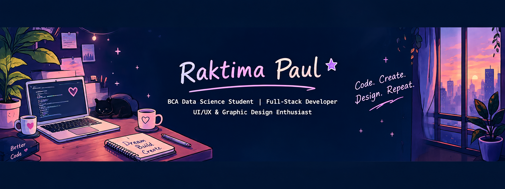

  

# Hey there, I'm Raktima Paul! 👋

### 🎨 Creative Thinker | 💻 Aspiring Full-Stack Developer | 📊 BCA Data Science Student

I love bringing **code and creativity together** to build engaging, meaningful, and user-friendly digital experiences. My interests span frontend development, backend development, graphic design, UI/UX design, application development, and data science.

I'm currently strengthening my web development skills, exploring backend technologies, and working toward becoming a **Full-Stack Developer**. I enjoy experimenting with new ideas, creating visual experiences, and turning concepts into practical projects.

- 🎓 Pursuing BCA in Data Science at Presidency University, Bengaluru.
- 💻 Building projects and improving my programming skills.
- 🌐 Learning frontend and backend development on my journey toward full-stack development.
- 🎨 Interested in graphic design, visual storytelling, typography, UI/UX, and creative digital experiences.
- 📱 Exploring Android and mobile application development with Kotlin.
- 🧠 Interested in data science, machine learning, and pattern recognition.
- 🤝 Open to internships, collaborations, and learning opportunities.

---

## 🛠️ Skills & Technologies

### 💻 Programming Languages
`Python` `Java` `JavaScript` `C` `C#` `Kotlin` `SQL`

### 🌐 Web Development
`HTML5` `CSS3` `JavaScript` `Frontend Development` `Responsive Web Design`

### ⚙️ Backend & Full-Stack Development
`Backend Development — Learning` `Full-Stack Development — Learning`

### 🎨 Design & Creativity
`Graphic Design` `UI Design` `UX Design` `Figma` `Wireframing` `Prototyping` `Visual Design` `Typography` `Color Theory` `Canva` `Adobe Design Tools`

### 📊 Data Science & AI
`Data Science` `Machine Learning` `Pattern Recognition` `Data Structures` `Algorithms` `Problem Solving`

### 📱 Application Development
`Android Development` `Kotlin` `Android Studio` `Mobile App Design`

### 🔧 Tools & Platforms
`Git` `GitHub` `Visual Studio Code` `Android Studio`

## 🌐 Web Development

## 🎨 Design & Creativity

## 🛠️ Tools & Platforms

---

## 🚀 Featured Projects

### 🌐 1. Quizora — Interactive Quiz Web Application

An interactive web application designed to make online quizzes engaging and accessible, featuring quiz participation, results, and quiz creation functionality.

- **Focus:** Frontend development and interactive web experiences
- **Technologies:** HTML5, CSS3, JavaScript
- **Highlights:** Quiz interface, results screen, and quiz creation functionality
- 🔗 [Explore my repositories](https://github.com/Raktima-1102?tab=repositories)

### 🏦 2. Banking App UI Design

A mobile banking interface concept focused on intuitive navigation, visual consistency, and a clear user experience.

- **Focus:** UI/UX design and mobile interface design
- **Tool:** Figma
- **Highlights:** Multiple mobile banking screens and interface components
- 🔗 [View Banking App UI Design](https://github.com/Raktima-1102/banking-app-ui-design)

### ✅ 3. Taskly — Minimalist To-Do List App UI

A minimalist task management interface concept designed to make everyday task organisation simple and visually clear.

- **Focus:** Interface design, layout, and usability
- **Tool:** Figma
- **Highlights:** Task list and add-new-task screens
- 🔗 [Explore my repositories](https://github.com/Raktima-1102?tab=repositories)

### ⏱️ 4. TimeBridge — Productivity Tracking

An academic project focused on helping students understand their time-management patterns and study habits through productivity insights.

- **Focus:** Productivity analytics and data-driven insights
- **Highlights:** Time-management patterns and productivity visualisation

### 🖐️ 5. Gesture Control Cursor

An academic project exploring touchless computer interaction through hand gestures, enabling real-time cursor movement and actions.

- **Focus:** Gesture-based interaction and human-computer interaction
- **Highlights:** Hands-free interaction and real-time control

### 💡 6. Mini Programming Projects

A collection of small applications developed to strengthen programming fundamentals, logical thinking, and problem-solving skills.

- Calculator
- Stopwatch
- Traffic-Light System
- Card System
- ATM System

🔗 [Explore all my repositories](https://github.com/Raktima-1102?tab=repositories)

---

## 🏆 Achievements & Recognition

🥇 **1st Position — Smart India Hackathon 2026**

Student Innovation Category | College Level

🥈 **2nd Position — Innovate to Incubate Campus Challenge 2025**

Recognised for innovation, creative problem-solving, and developing ideas with practical potential.

🥉 **3rd Position — Creovation Conclave 2025**

Recognised for creativity, innovation, and design-oriented thinking.

---

## 🎯 Currently Learning

- 🌐 Frontend development and responsive web design.
- ⚙️ Backend development as part of my full-stack learning journey.
- 🎨 Graphic design and visual communication.
- 📱 Application development and interactive digital experiences.
- 🧠 Data science and machine learning.

---

## 💡 What I Enjoy

- Building useful and engaging digital experiences.
- Exploring the intersection of design and technology.
- Creating visually appealing graphics and interfaces.
- Solving problems through programming and creative thinking.
- Learning new technologies and applying them through projects.

---

## 🌐 Let's Connect!

- 💻 **GitHub:** [Raktima-1102](https://github.com/Raktima-1102)
- 💼 **LinkedIn:** [Connect with me](https://www.linkedin.com/in/raktima-paul-bca-data-science-b1a8ba33b/)
- 📧 **Email:** [raktimapaul05@gmail.com](mailto:raktimapaul05@gmail.com)

---

### ✨ Code. Create. Design. Repeat.

*Building at the intersection of technology and creativity, one project at a time.* 🚀

## 💻 Programming Languages

## 🌐 Web Development

## 🎨 Design & Creativity

## 🛠️ Tools & Platforms

## 📊 Areas of Interest

`Data Science` · `Machine Learning` · `Pattern Recognition` · `Responsive Web Design` · `Application Development` · `Visual Design` · `Typography` · `Problem Solving`
